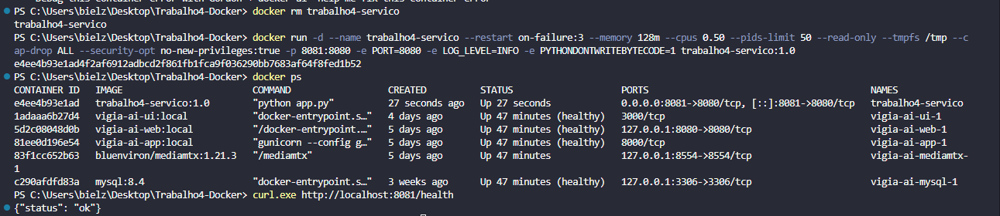
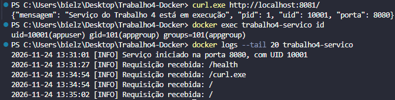
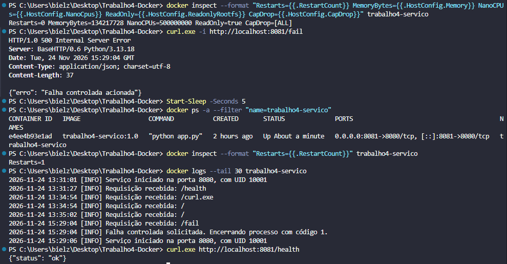
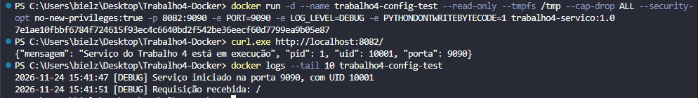
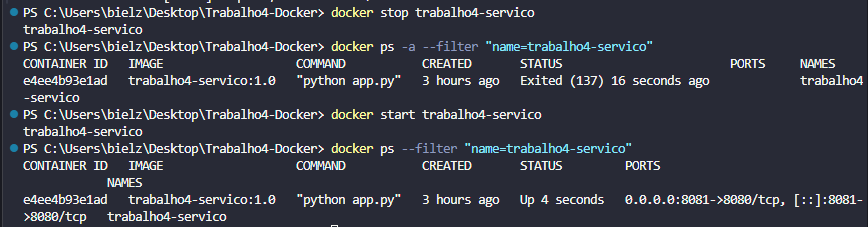

# Trabalho 4 - Operacionalização segura de um serviço Linux com Docker

## Identificação

- **Aluno:** Henry Gabriel Lopes Lêda
- **Disciplina:** Sistemas Operacionais
- **Curso:** Análise e Desenvolvimento de Sistemas
- **Professor:** Guibson Krause
- **Modalidade:** Individual

## Objetivo

Criar e operar uma aplicação HTTP simples em um container Docker. O serviço deve permitir construção reproduzível, configuração externa, execução com usuário sem privilégios, consulta de logs, limitação de recursos, recuperação após falha e parada normal.

O trabalho retoma conceitos do Trabalho 1: a aplicação possui um processo principal identificado dentro do container como PID `1`, executado pelo usuário `appuser`, UID `10001`. Também retoma o Trabalho 3 por registrar evidências de execução, logs e comportamento após uma falha.

## Aplicação

A aplicação foi criada em Python com recursos nativos da linguagem. Ela oferece as rotas abaixo:

| Rota | Finalidade |
|---|---|
| `GET /` | Confirma que o serviço está em execução e informa PID, UID e porta interna |
| `GET /health` | Rota simples para testar a disponibilidade |
| `GET /fail` | Provoca uma falha controlada e encerra o processo com código `1` |

A rota `/fail` existe somente para testes no ambiente de laboratório. Ela permite demonstrar a política de reinício automático do Docker.

## Ambiente utilizado

- Windows com Docker Desktop
- Contexto Docker: `desktop-linux`
- Imagem base: `python:3.13-slim`
- Porta interna do serviço: `8080`
- Porta externa usada no teste: `8081`
- Imagem criada: `trabalho4-servico:1.0`

A porta externa `8081` foi utilizada porque a porta `8080` do computador já estava ocupada por outro serviço local.

## Estrutura do projeto

```text
Trabalho4-Docker/
├── app.py
├── Dockerfile
├── README.md
└── evidencias/
    ├── 01-container-e-health.png
    ├── 02-usuario-e-logs.png
    ├── 03-falha-e-recuperacao.png
    ├── 04-configuracao-externa.png
    └── 05-parada-normal.png
```

## Segurança e isolamento

O Dockerfile cria o usuário `appuser`, com UID `10001`, e executa a aplicação com esse usuário. Portanto, o processo não é executado como root.

O container foi iniciado com as seguintes proteções:

- `--read-only`: sistema de arquivos do container em modo somente leitura.
- `--tmpfs /tmp`: cria uma área temporária em memória.
- `--cap-drop ALL`: remove capabilities Linux desnecessárias.
- `--security-opt no-new-privileges:true`: impede ganho de privilégios.
- `--memory 128m`: limita o uso de memória a 128 MB.
- `--cpus 0.50`: limita o uso a 0,5 CPU.
- `--pids-limit 50`: limita a quantidade de processos.

A aplicação usa a porta interna `8080`, acima de 1024, por isso o usuário sem privilégios consegue iniciar o serviço sem necessidade de permissões administrativas.

## Configuração externa

A aplicação lê as variáveis abaixo:

| Variável | Valor padrão | Finalidade |
|---|---:|---|
| `PORT` | `8080` | Define a porta interna do serviço |
| `LOG_LEVEL` | `INFO` | Define o nível exibido nos logs |
| `PYTHONDONTWRITEBYTECODE` | não definido | Evita arquivos `.pyc` no sistema de arquivos somente leitura |

Durante a execução principal, foram usados `PORT=8080` e `LOG_LEVEL=INFO`.

A configuração externa também foi comprovada com outro container, sem editar o código:

```powershell
docker run -d --name trabalho4-config-test --read-only --tmpfs /tmp --cap-drop ALL --security-opt no-new-privileges:true -p 8082:9090 -e PORT=9090 -e LOG_LEVEL=DEBUG -e PYTHONDONTWRITEBYTECODE=1 trabalho4-servico:1.0
```

Nesse teste, a resposta informou a porta interna `9090`, e os logs mostraram mensagens no nível `DEBUG`.

## Runbook de operação

### 1. Pré-requisitos

Instalar e iniciar o Docker Desktop. Confirmar o funcionamento:

```powershell
docker version
```

### 2. Construir a imagem

Na pasta do projeto:

```powershell
docker build -t trabalho4-servico:1.0 .
```

### 3. Iniciar o serviço

```powershell
docker run -d --name trabalho4-servico --restart on-failure:3 --memory 128m --cpus 0.50 --pids-limit 50 --read-only --tmpfs /tmp --cap-drop ALL --security-opt no-new-privileges:true -p 8081:8080 -e PORT=8080 -e LOG_LEVEL=INFO -e PYTHONDONTWRITEBYTECODE=1 trabalho4-servico:1.0
```

### 4. Conferir o estado e testar a aplicação

```powershell
docker ps
curl.exe http://localhost:8081/health
curl.exe http://localhost:8081/
```

A rota principal deve informar que o serviço está em execução, com PID `1`, UID `10001` e porta interna `8080`.

### 5. Conferir o usuário efetivo

```powershell
docker exec trabalho4-servico id
```

Resultado esperado:

```text
uid=10001(appuser) gid=101(appgroup) groups=101(appgroup)
```

### 6. Consultar os logs

```powershell
docker logs --tail 20 trabalho4-servico
```

Os logs mostram a inicialização e as requisições recebidas pela aplicação.

### 7. Conferir limites e isolamento

```powershell
docker inspect --format "Restarts={{.RestartCount}} MemoryBytes={{.HostConfig.Memory}} NanoCPUs={{.HostConfig.NanoCpus}} ReadOnly={{.HostConfig.ReadonlyRootfs}} CapDrop={{.HostConfig.CapDrop}}" trabalho4-servico
```

Valores observados:

```text
Restarts=0
MemoryBytes=134217728
NanoCPUs=500000000
ReadOnly=true
CapDrop=[ALL]
```

### 8. Simular uma falha controlada

Deixar o container em execução por pelo menos 10 segundos e executar:

```powershell
curl.exe -i http://localhost:8081/fail
```

A rota responde HTTP 500 e encerra o processo principal com código `1`.

### 9. Confirmar a recuperação automática

Aguardar cinco segundos e executar:

```powershell
docker ps -a --filter "name=trabalho4-servico"
docker inspect --format "Restarts={{.RestartCount}}" trabalho4-servico
docker logs --tail 30 trabalho4-servico
curl.exe http://localhost:8081/health
```

No teste realizado, o contador passou de `Restarts=0` para `Restarts=1`. Os logs registraram a falha e uma nova inicialização do serviço. A rota `/health` respondeu novamente com `{"status":"ok"}`.

### 10. Parar normalmente

```powershell
docker stop trabalho4-servico
docker ps -a --filter "name=trabalho4-servico"
```

A parada normal não deve disparar a política `on-failure`. Para iniciar novamente:

```powershell
docker start trabalho4-servico
docker ps --filter "name=trabalho4-servico"
```

## Evidências

### Serviço em execução e teste de disponibilidade



A captura mostra o container `trabalho4-servico` ativo e a rota `/health` respondendo corretamente.

### Usuário efetivo e logs



O comando `docker exec trabalho4-servico id` comprova o UID `10001`, diferente de root. Os logs registram a inicialização e as requisições HTTP.

### Falha controlada e recuperação automática



A rota `/fail` respondeu HTTP 500. Depois, o contador de reinícios passou para `1`, os logs registraram uma nova inicialização e a rota `/health` voltou a responder.

### Configuração externa



O container temporário usou `PORT=9090` e `LOG_LEVEL=DEBUG`, configurados no comando Docker, sem modificação do código-fonte.

### Parada normal e nova inicialização



O `docker stop` encerrou normalmente o container. Em seguida, `docker start` colocou o serviço novamente em execução.

## Conclusão

O serviço foi operacionalizado em um container Docker de forma reproduzível e com medidas básicas de segurança. A aplicação executa sem privilégios administrativos, recebe configuração por variáveis de ambiente, registra eventos úteis, possui limites de recursos e recupera-se automaticamente quando o processo principal falha.

A demonstração confirmou a diferença entre uma falha controlada, que aciona `on-failure`, e uma parada normal com `docker stop`, que encerra o container sem reinício automático.